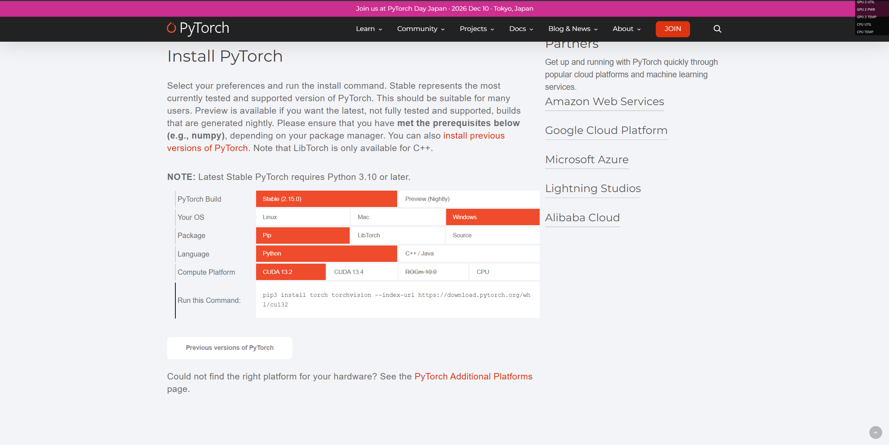
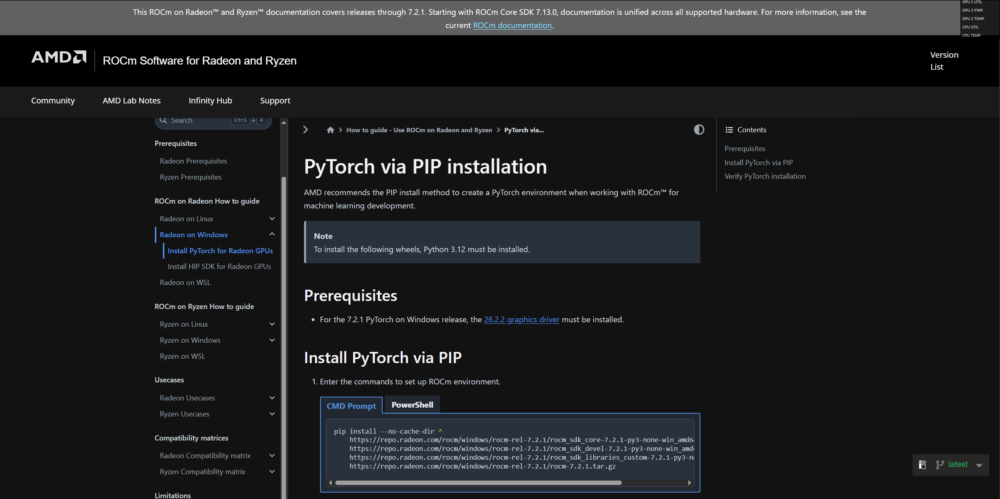

# ASL-Webcam-Transcriber

## Overview
ASL Camera Interpreter is a real-time American Sign Language (ASL) translator built in Python. Letters signed in front of
the webcam are translated on screen and built into words. The project combines computer vision, hand landmark detection,
and a neural network trained on hand sign images to support accessible communication in digital environments.

### How it works
1. **Access to the camera:** frames are read from your webcam with OpenCV
2. **Hand landmarking:** MediaPipe finds your hand and maps it into 21 landmark points
3. **Normalization:** the landmarks are normalized to better map your hand and the sign you're making, no matter where your hand is on screen or how far it is from the camera
4. **Letter classification:** an MLP model trained on the letters dataset translates the sign shown on the webcam into a letter
5. **Word building:** a WordBuilder builds words out of the letters seen on the screen, and showing an open hand clears the screen after the word has been built

### Features
- Real-time translation of ASL letters shown on the webcam
- Builds full words out of the letters you sign
- Trained on a Kaggle dataset of hand signs, using a script that extracts landmark data from the images
- Can collect your own training samples straight from the webcam
- Benchmarking to collect stats pertaining to the application and the model (latency, FPS, prediction speed, and per-letter accuracy)

### Next Steps
- Implement translation for full words and not just letters
    - This would require a different model and a different dataset as the current model cannot handle things like movement or two-handed signs, additionally I would need to implement a way for the model to recognize the hand in relation to parts of the body
- Creating a WebUI and potentially deploying it, so that it can be used and tested without the need to install the app on your device

### Project Structure Note
All of the current work is in the `ASL-Interpreter-V2` folder. The `ASL-interpreter` folder is the original version of the project, where some of the hand configurations for certain words were implemented.

## Installing Dependencies

### Setup/Dependencies
You will need **Python 3.11** installed (mediapipe does not support every newer Python version, so 3.11 is the safe choice).

First go into the project folder:
```
cd ASL-Interpreter-V2
```

Then set up the virtual environment. The terminal command (on Windows) is:
```
py -3.11 -m venv venv311
```

And then you will install your dependencies onto the virtual environment.
Use the following command to enter the virtual environment, when you are installing your dependencies or doing any other work afterwards:
```
venv311\Scripts\activate
```

You will need to install the following dependencies
- opencv-python
- mediapipe
- numpy
- torch

You can download all of the dependencies (except torch) using this terminal command (on Windows):
```
pip install opencv-python mediapipe numpy
```

If you have errors with installing the dependencies, and the error tells you to update pip, go ahead and use the command given by the error message to update pip in the virtual environment
(Do not forget to go into the virtual environment first, using the command given above, before you do the update)

To install torch you can go to this link

https://pytorch.org/

Scroll down to the install selector, choose your preferences (OS, pip, Python, and your CUDA version or CPU), and use the command given to you at the bottom.
For reference, this is the command for CUDA 12.8:
```
pip3 install torch torchvision --index-url https://download.pytorch.org/whl/cu132
```


The letter model is very small, so the CPU version of torch works fine too, but it will take longer depending on the CPU.

### AMD GPU users (ROCm)
If you have an AMD GPU, you install the ROCm build of torch instead of the CUDA one.
ROCm builds are made for specific GPU architectures, so first find yours (for example, RX 9070/9060 series is `gfx1201`, RX 7900 series is `gfx1100`).
You can check which GPUs are supported here:

https://rocm.docs.amd.com/projects/install-on-windows/en/latest/reference/system-requirements.html

**On Windows:**
1. Update to the latest AMD Adrenalin driver
2. Go into the virtual environment (see the command above)
3. Follow AMD's instructions for installing PyTorch on Windows, and use the install command for your GPU architecture:

   https://rocm.docs.amd.com/projects/radeon-ryzen/en/latest/docs/install/installrad/windows/install-pytorch.html

   This installs `torch`, `torchvision`, and the `rocm_sdk` packages into the virtual environment (for reference, mine is ROCm 10.1 with `rocm_sdk_device_gfx1201` for an RX 9070 series card)



**On Linux:**
Go to https://pytorch.org/, choose **ROCm** as the compute platform, and use the command given at the bottom. It will look something like:
```
pip install torch torchvision --index-url https://download.pytorch.org/whl/rocm6.4
```

**Checking that it works:**
ROCm builds of torch still use the `cuda` name, so the code doesn't need to change. Run this in the virtual environment:
```
python -c "import torch; print(torch.cuda.is_available(), torch.cuda.get_device_name(0))"
```
It should print `True` and the name of your AMD GPU.

**Note:** `letter_convert.py` currently trains on `cuda:1` (the second GPU). If you only have one GPU (or `cuda:1` isn't the GPU you want), change line 15 of `letter_convert.py` to:
```
device = "cuda" if torch.cuda.is_available() else "cpu"
```

## Things/Commands to Know
Remember all commands and work is to be done in the python virtual environment, from inside the `ASL-Interpreter-V2` folder.
Refer to the Setup/Dependencies section above for the command to enter the virtual environment.

### Running the app
Once all the dependencies have been installed, you can start the webcam interpreter with:
```
python main.py
```
- Hold up **one hand** and sign a letter, the predicted letter shows on screen
- Holding a letter adds it to the word being built
- Show an **open hand (all five fingers spread)** to finish/clear the current word
- Press **a-z** on the keyboard to save the current hand position as a training sample for that letter (saved to `data/letters.csv`)
- Press **Esc** to quit, after quitting the app prints latency/FPS stats

### Getting the dataset
The model is trained on the Kaggle ASL Alphabet dataset:

https://www.kaggle.com/datasets/grassknoted/asl-alphabet

Download it and extract it into `data/raw/` so that you end up with
```
data/raw/asl_alphabet_train/asl_alphabet_train/A/...
data/raw/asl_alphabet_test/asl_alphabet_test/...
```

### Converting the dataset to landmarks
The model doesn't train on images directly, it trains on hand landmarks. To run every training image through mediapipe and save the normalized landmarks to `data/converted/letters.csv`, use:
```
python kaggle_converter.py
```
This takes a while since it goes through every image. (`del`, `nothing`, and `space` classes are skipped.)

### Training the letter model
To train the MLP on the converted landmarks and save it to `models/letters.pt`, use:
```
python letter_convert.py
```

### Benchmarking
To measure prediction speed, model size, and per-letter accuracy, use:
```
python benchmark.py
```

### Files
- `main.py` - the webcam app
- `landmarks.py` - `HandTracker` (mediapipe hand landmarking) and landmark normalization
- `letter_convert.py` - the `LetterMLP` model and training script
- `letter_signs.py` - `LetterClassification`, loads the trained model and predicts letters
- `create_strings.py` - `WordBuilder`, builds words out of the letters seen on screen
- `kaggle_converter.py` - converts the Kaggle images into landmark data
- `benchmark.py` - benchmarking/stats for the app and the model
- `hand_landmarker.task` - the mediapipe hand landmarker model
